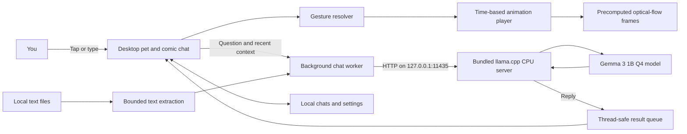
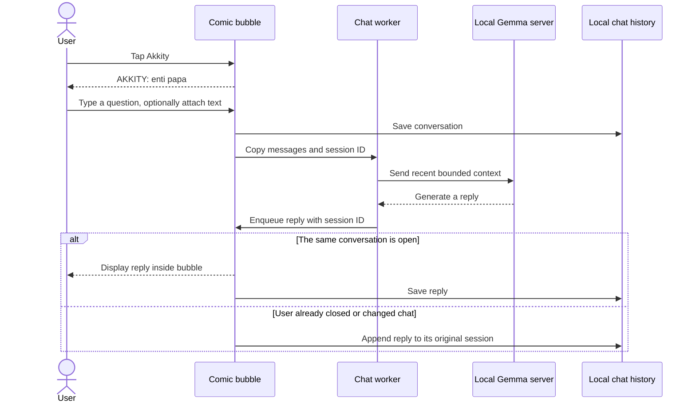
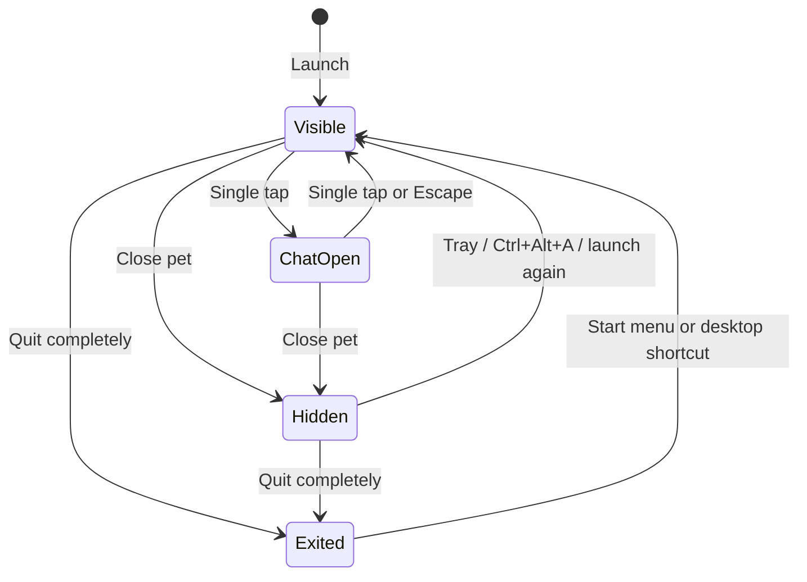

<p align="center"></p>
<h1 align="center">Akkity</h1>
<p align="center"><strong>Tiny cat. Big desktop energy.</strong><br>A Windows desktop companion with a bundled offline AI brain.</p>
<p align="center"><a href="https://akkity.web.app">Website</a> · <a href="https://github.com/hydra-eng/akkity/releases/latest">Download for Windows</a> · <a href="#how-it-works">Architecture</a> · <a href="#development">Development</a></p>

## Meet your desktop roommate

Akkity is a small black cat that walks, jumps, waves, and chats beside your work. The Windows installer includes the Python runtime, CPU inference engine, and Gemma 3 1B model. You do not need an account, API key, Python installation, or a separate model download.

**Download:** open [Akkity's website](https://akkity.web.app), download `Akkity-Setup.exe`, accept the bundled model terms, and install. The installer creates Start menu and desktop shortcuts and can launch Akkity immediately.

| Feature | Behavior |
| --- | --- |
| Offline chat | Gemma 3 1B runs on your CPU through a loopback-only inference server |
| Smooth motion | Six optical-flow subframes per original pose interval; time-based playback and eased walking |
| Desktop companion | Transparent, always-on-top pet that can be dragged across your screen |
| Comic chat | Compact adjacent speech bubble; greeting is part of the conversation |
| File context | Text, code, CSV, DOCX and text PDFs, extracted locally |
| Chat tools | Summarize, explain, checklist, search, copy, export and saved history |
| Focus timer | Pause wandering while you work, then a little celebration |
| Preferences | Idle interval, walking speed, animation cadence, font, bubble size and gestures |
| Easy reopening | Tray icon, Ctrl+Alt+A, Start menu and desktop shortcut |

## Controls

| Gesture | Default action |
| --- | --- |
| Single tap | Toggle chat; each fresh opening starts with **AKKITY: enti papa** |
| Double tap | Jump |
| Triple tap | Wave and jump celebration |
| Drag | Move the pet |
| Right click | Chat, settings or hide pet |
| Close pet | Hide the pet; tray and global shortcut remain available |
| Ctrl+Alt+A | Reopen the pet while the tray process is running |
| Tray → Quit completely | Exit the app; reopen through its installed shortcuts |
| Ctrl+O / Ctrl+F / Escape | Attach file / find text / close chat |

Windows can reserve a shortcut for another app. If Ctrl+Alt+A is unavailable, use the tray icon or Start menu. An installed desktop shortcut also carries Ctrl+Alt+A, which Windows may use to launch the application when it is fully exited.

## How it works



### A conversation's lifecycle



### Pet visibility



### Animation pipeline

The source atlas contains nine actions with 4–8 key poses each. `scripts/build_motion.py` estimates bidirectional dense optical flow between adjacent poses, warps premultiplied RGBA in both directions, and creates six samples per interval. These frames are precomputed; OpenCV is **not** needed by end users. A 16 ms UI tick selects frames by elapsed time, rather than letting timer delays accumulate. Walking uses elapsed-time movement with smooth acceleration and deceleration.

This is interpolated 2D artwork, not a 3D rig. Large pose differences can still produce interpolation distortion. Frame cadence can be adjusted in settings; the display rate and CPU load affect perceived smoothness.

## Privacy and limits

- The desktop application sends chat requests only to `127.0.0.1:11435`. There is no cloud chat service, telemetry, account system or automatic update checker.
- Chats and preferences are saved in `%LOCALAPPDATA%\Akkity`. Attached text is included in saved conversations; the original file is not copied.
- The local server binds to loopback. Other processes running on the same computer may access that port. It is not designed as a shared or remotely accessible service.
- Attachments: 2 MB maximum file size, 5,000 extracted characters, up to the first 15 PDF pages. Image/scanned PDFs, audio and pictures are unsupported.
- Replies are limited to 180 generated tokens and recent context. This small model can be wrong; check important answers.
- Akkity does not browse the web, execute model-generated code, or control other applications.
- The website uses Google Fonts and links to GitHub downloads. Those web services have their own privacy policies; desktop chats are not sent to them.

## System requirements

- Windows 10 or 11, x64.
- At least 2 GB free disk space; 8 GB RAM recommended.
- CPU inference; no dedicated GPU needed. Reply speed varies by hardware.
- Internet for the installer download only. The model is about 806 MB before packaging.
- Community installer is unsigned. Windows may show an unknown-publisher warning. Use the official release and compare its SHA-256 with `SHA256SUMS.txt`.

## Development

```text
app/                 Tkinter pet, chat, file extraction, tray integration
app/motion/          Precomputed transparent animation strips
scripts/             Motion generation, Windows build and installer
site/                Responsive static download website
licenses/            Bundled model terms and third-party notices
firebase.json        Firebase Hosting configuration
```

Use Python 3.12 on Windows:

```powershell
python -m venv .venv
.\.venv\Scripts\Activate.ps1
pip install -r requirements-build.txt
python scripts/build_motion.py
```

Place the CPU runtime at `app/runtime/lib/ollama/llama-server.exe` with its sibling DLLs and licenses, and the Gemma blob under `app/models/blobs/`. The model filename and SHA-256 are listed in `NOTICE.txt`. Obtain the model from the upstream Ollama registry subject to the Gemma terms. These large binary dependencies are distributed in the release installer, not stored in Git.

```powershell
python app/akkity.py
```

### Build the offline installer

Install Inno Setup from its official source. Prepare a payload directory containing `runtime/` and `models/`, then run:

```powershell
powershell -ExecutionPolicy Bypass -File scripts/build.ps1 `
  -PayloadRoot C:\path\to\payload `
  -Python .venv\Scripts\python.exe `
  -ISCC "C:\path\to\Inno Setup\ISCC.exe"
```

The script verifies the model checksum, builds the standalone app, copies only application dependencies (never local chats/settings), and emits `releases/Akkity-Setup.exe`, `SHA256SUMS.txt` and website release metadata. Installation is per-user and needs no administrator privileges. Uninstalling removes installed binaries; local conversations remain in LocalAppData.

### Website

Buildless HTML/CSS/JavaScript. Preview with `python -m http.server 8765 --directory site`. Deployment uses Firebase Hosting project `akkity`:

```powershell
firebase deploy --only hosting --project akkity
```

The website links to the GitHub release asset, keeping the large offline installer out of Firebase Hosting. No Firebase database or authentication service is used.

## Licenses and credits

Application code, website and documentation: [MIT](LICENSE). AI-generated pet artwork accompanies the project. Gemma 3 is distributed under the [Gemma Terms of Use](https://ai.google.dev/gemma/terms), including its use restrictions; see [NOTICE.txt](NOTICE.txt) and `licenses/`. CPU inference uses llama.cpp distributed through Ollama, with license notices retained. This project is independent of Google, Ollama, Microsoft and OpenAI.

Architecture diagrams are written in Mermaid and render directly on GitHub.
